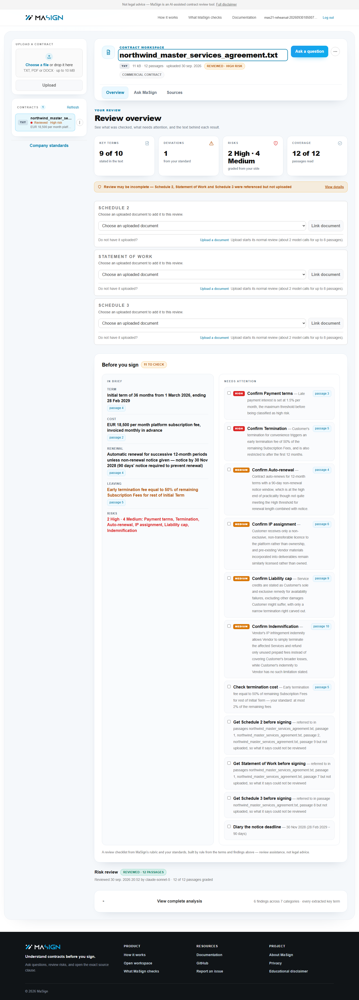

# MaSign

MaSign is an AI-assisted contract review tool for finding key terms, possible
risks, and cited answers in uploaded agreements. It combines document storage,
semantic search, question answering, and contract-risk analysis.

The application is not intended to replace a lawyer or make final legal decisions. Its purpose is to provide a useful first analysis, highlight clauses that deserve attention, and help users locate the original contract passages behind an answer.

**Tech stack:** FastAPI · PostgreSQL · Qdrant · React/Vite · LiteLLM · Docker

Answers link to contract passages; answers that fail the citation or value checks are flagged as unverified. These checks do not establish legal or factual correctness.

<a href="docs/demo-evidence/2026-09-30/northwind-overview.png"></a>

*Recorded UI from the fictional Northwind contract, 2026-09-30. Open the image for full size; [demo evidence](docs/demo-evidence/2026-09-30.md) records the build and checks. Later features are not shown.*

## What It Does

A signed-in user uploads a contract. MaSign then:

1. Reads and processes the uploaded document.
2. Divides the contract into smaller, meaningful sections.
3. Stores the contract and its basic metadata.
4. Converts contract text into embeddings for semantic search.
5. Lets users ask natural-language questions about the contract.
6. Identifies potentially risky clauses and explains why they may matter.

Example questions include:

- What are the termination conditions?
- Is there an automatic renewal clause?
- What penalties can be charged?
- Who is responsible if something goes wrong?
- Are there unusual payment terms?

## Problem It Solves

Contracts are often long, technical, and time-consuming to review. Important obligations, deadlines, penalties, and risk terms can be hidden across many pages. This assistant helps users perform an initial review more quickly by finding relevant sections, explaining them in plain language, and pointing back to the source text.

## Intended Users

- Small businesses reviewing supplier or customer contracts
- People reading an agreement before discussing it with a professional
- Project managers checking obligations and deadlines
- Legal teams performing an initial contract review
- People comparing the terms of two uploaded agreements

## Example Scenario

A company uploads a 30-page supplier agreement. The assistant finds a clause allowing automatic renewal, identifies a large late-payment penalty, and shows the sections describing how the agreement can be terminated. The user can then examine those exact passages or take them to a lawyer.

## Architecture at a glance

FastAPI (`app/`) serves the React/Vite frontend (`frontend/`) and the API.
Uploads pass through `app/ingestion/` to extract text and split it into
passages. Postgres stores accounts, contracts, passages, links, reviews, key
terms, and question history; Qdrant stores passage embeddings for semantic
search. `app/retrieval/` finds relevant passages for a question. The configured
chat provider produces cited answers and, in a background job after upload,
the risk review and key terms. Verification and coverage rules can mark a
result incomplete; a missing or unusable source does not become a clean bill
of health. See [docs/architecture.md](docs/architecture.md) for the data flow
and schema details.

## Evaluation

The [2026-09-28 retrieval run](docs/evaluation/results-2026-09-28-live-all-three.md)
found the reference passage first for 28 of 35 questions (hit@1 0.80), and
within the top five for all 35 (hit@5 1.00) using the quality embedding
profile. These are retrieval scores, not answer accuracy. A separate
[six-question judged run](docs/evaluation/results-2026-09-28-judged-cuad.md)
reported 0.88 faithfulness and 0.59 factual correctness with two of two
not-found questions handled correctly. That small answer sample does not
establish reliability for other contracts or legal decisions.

`docs/evaluation/` holds the question set, the results and how to run the
harness: `python -m evaluation.evaluate --retrieval-only` measures retrieval
(hit@1, hit@5, MRR) against the running stack with **no** model call, and
`--judge` scores the real system's answers with Ragas (faithfulness, factual
correctness) through a Haiku judge — paid, so it prints its estimate and
refuses without `--yes`. `GET /api/contracts/{id}/search?q=` is the
retrieval-only endpoint it uses. See [evaluation instructions](docs/evaluation/README.md).

## API overview

- Upload and manage documents in a signed-in personal workspace.
- Read stored reviews, key terms, coverage and source passages.
- Retrieve passages without a model call, or ask questions with the configured chat provider.
- Link contract bundles and export stored review results.

See the [endpoint reference](docs/api.md), or `/docs` on a running instance for interactive request and response schemas.

## Quick start with Docker

Install Docker with Compose, then run these commands from the repository root:

```bash
cp .env.example .env
docker compose up --build
```

Open `http://localhost:8000`, create an account, and sign in to your personal
workspace. The first start downloads the local embedding model, so it can take
longer than subsequent starts. Check `http://localhost:8000/ready` for Postgres
and Qdrant readiness; `chat_model: "not configured"` means those stores are
ready but AI review and answers are not.

To use contract review and Ask MaSign, set `ANTHROPIC_API_KEY` in your local
`.env` (the default provider), or set `CHAT_PROVIDER=openai` and
`OPENAI_API_KEY`. Restart the API after changing `.env`. Uploading a contract
starts a background review that sends contract passages to the chosen provider;
asking a question also sends relevant passages and the question. These calls
can incur charges. Without a provider key, the site and account flow still
work, but a contract's review fails and Ask MaSign cannot answer. Do not use a
real contract until you are comfortable sending its text to that provider.

In the workspace, upload a TXT, PDF, or DOCX file (up to 10 MB), select it from
the list, and wait for the review status to finish. Overview shows key terms,
possible risks, and how much text was checked. Select a cited passage to read
its source in Sources; use Ask MaSign to ask a question about the selected
contract. The API reference is at `http://localhost:8000/docs`. Stop the stack
without deleting its saved data with `docker compose down`.

## Local API setup

The API needs Postgres and Qdrant; run only those two services with Compose.
Create a Python 3.12 virtual environment, then activate it for your shell:

```bash
docker compose up -d postgres qdrant
python -m venv .venv
```

Check that `python --version` reports Python 3.12. On Windows Git Bash use
`source .venv/Scripts/activate`; on macOS/Linux use
`source .venv/bin/activate`; on Windows PowerShell use
`.\.venv\Scripts\Activate.ps1`. Then run:

```bash
pip install -r requirements.txt
cp .env.example .env
uvicorn app.main:app --reload
```

On startup the API applies pending migrations. Without a frontend build, the
root redirects to `/docs`; run `npm ci` and `npm run dev` from `frontend/` for
the UI at `http://localhost:5173` (API requests proxy to port 8000). If
Postgres is unreachable, the API refuses to start and says so.

## Docker Services

```bash
docker compose up --build
```

The compose file starts three services:

| Service    | Container         | Host port | Notes                                        |
|------------|-------------------|-----------|----------------------------------------------|
| `api`      | `masign-api`      | 8000      | FastAPI app, waits for Postgres to be healthy |
| `postgres` | `masign-postgres` | 5433      | Dev-only credentials (`rag_user`/`rag_password`); 5433 on the host to avoid clashing with a native PostgreSQL on 5432 |
| `qdrant`   | `masign-qdrant`   | 6333/6334 | Vector store                                  |

Inside the compose network the API reaches the other services by name
(`postgres`, `qdrant`); `docker-compose.yml` overrides `DATABASE_URL` and
`VECTOR_STORE_URL` accordingly. A local `.env` is loaded if present (for the
chosen provider key and other settings), but is not required to start the stack.

Check it is up:

```bash
curl http://localhost:8000/ready
```

The Docker image includes the frontend at `http://localhost:8000`. Answers
link to source passages and show when they could not be verified. Actions
report their outcome in a toast; errors show the API's message. The
interactive API docs remain at `/docs`.

### Embedding profiles

The deployer picks a *default* profile that always runs (benchmark and
rationale in [embedding models](docs/embedding-models.md); every model tried, compared side by side,
in [`docs/embedding-models.md`](docs/embedding-models.md)). Switching changes
the index fingerprint, so on the next start the vector index is rebuilt
automatically from the stored chunk text — nothing has to be re-uploaded.

| Profile | Command | Model | Needs | ≈ 30-page contract |
|---|---|---|---|---|
| `portable` (default) | `docker compose up` | ModernBERT (legal fine-tune), in-process | any laptop; first start downloads ~600 MB into `hf_cache` | ~30 s on CPU, ~5 s on a GPU |
| `quality` (replaces `portable`) | `docker compose -f docker-compose.yml -f docker-compose.llama-server.yml -f docker-compose.quality.yml up` | Qwen3-Embedding-4B Q4_K_M via `llama-server` | NVIDIA GPU with ≥3 GB free VRAM, CUDA 12.x driver, Docker GPU access; first start downloads a 2.5 GB GGUF into `llama_models` | ~25 s on a 4 GB Quadro P1000 (3.7 GB VRAM in use) |

`docker-compose.llama-server.yml` is the GPU inference server on
its own, shared by the row above and by compare mode below — `quality`'s
`environment:` values are literal, so they always win over `.env` regardless
of file order, which is exactly why compare mode below never includes
`docker-compose.quality.yml`.

The `api` container ships CPU-only torch, so the `portable` profile runs on
the CPU there; running the API natively with a CUDA torch build and
`EMBEDDING_DEVICE=auto` (or `cuda`) uses the GPU. The `quality` profile
sets `EMBEDDING_BACKEND=openai-compatible` and points `EMBEDDING_API_URL` at
the `llama-server` service; any server speaking the OpenAI embeddings API
works the same way — one without llama-server's `/tokenize` endpoint also
needs `EMBEDDING_TOKENIZER` (the model's Hugging Face tokenizer) so token
counts stay exact (`.env.example` lists every setting). Both profiles serve
the same API, so nothing else changes there.

#### Compare mode

To run **both** profiles side by side in the same process — so a reviewer
can ask one question against each model and see the two answers together —
start `llama-server` *without* `docker-compose.quality.yml`:

```
docker compose -f docker-compose.yml -f docker-compose.llama-server.yml up --build
```

and set the same settings again with a `QUALITY_` prefix in `.env`
(`QUALITY_EMBEDDING_BACKEND`, `QUALITY_EMBEDDING_MODEL`,
`QUALITY_EMBEDDING_API_URL`, ... — `.env.example` has the full template);
the plain `EMBEDDING_*` variables keep meaning the `portable` profile,
unchanged, and are never read as a fallback for `quality`. This is a
separate, additive configuration surface — leaving `QUALITY_EMBEDDING_API_URL`
unset simply means compare mode is off: every upload indexes `portable` only
and `/api/query`'s `profile` field only ever accepts `"portable"`. When it is
set, every upload also indexes, best-effort, into a second Qdrant collection
(`{QDRANT_COLLECTION}_quality` by default) and `/api/query` accepts
`profile: "portable" | "quality"`. Requesting `"quality"` for a contract that
was never indexed into it (not configured at all, or configured after that
contract was uploaded) is a 409, not a silent answer from the wrong index.

**Never combine `docker-compose.quality.yml` with the `QUALITY_*`
variables.** `quality.yml`'s `environment:` values are literal YAML, which
always wins over anything `.env` sets for the *same* unprefixed keys,
regardless of `-f` order or `env_file` — so including it alongside
`QUALITY_*` does not give you `portable` + `quality`, it silently gives you
`quality` + `quality` under both labels (found live on `main-live`:
`docker exec masign-api env` showed `EMBEDDING_BACKEND=openai-compatible`
even with no `EMBEDDING_BACKEND` in `.env` at all, purely from `quality.yml`
still being included). `quality.yml` is only for the quality-*only* row in
the table above.

## Contract bundles

Some agreements depend on a separate Statement of Work, Order Form, or SLA.
When the review identifies one that was not uploaded, MaSign keeps the warning
visible until a reviewer explicitly links an uploaded document to that exact
reference. MaSign never decides from matching filenames or content alone.

The primary agreement and its directly linked documents are then reviewed and
searched together. Each citation, risk finding, key term, coverage item, and
export row still names the document and passage it came from. A linked document
also keeps its own separate review when opened on its own. Removing a link
marks the primary agreement's existing review as needing a new review, because
it may have relied on text that is no longer part of the bundle.

## Running the Tests

```bash
MASIGN_REQUIRE_DB=1 python -m pytest -q
```

Frontend (from `frontend/`, needs Node 24): `npm ci`, then `npm test`,
`npm run build`, and `npm run lint`. `npm run dev` serves the UI on :5173
with `/api` proxied to a locally running API. See `frontend/README.md`.

Tests that need Postgres use a separate `contract_rag_test` database, created
automatically from `DATABASE_URL` and emptied after each test — your dev data
is never touched. Without a reachable Postgres they are skipped; set
`MASIGN_REQUIRE_DB=1` (as CI does) to make that a failure instead.

## Verification and coverage

Findings and key terms require source quotes. Unreadable, withheld, incomplete and not-stated results are distinct states. Pattern-based prompt-injection filtering has limits; it is not a complete defence. See [review behaviour](docs/review-behaviour.md) for the checks, coverage rules and guardrail limitations.

## Known limitations

Explicitly out of scope this cycle:

- **OCR for scanned documents.** A PDF with no extractable text layer is a
  422, not a best-effort image read (`app/ingestion/`).
- **Contract generation or redlining.** MaSign reads and analyzes an
  existing contract; it never drafts or edits clause text.
- **E-signature.** No signing workflow of any kind.
- **Public, multi-tenant deployment.** Real accounts and personal workspaces
  exist since MAS-143 (email + password, Argon2id-hashed — see "Security and
  secrets" below), but the model is one workspace per account with no
  sharing between accounts; it is not built or hardened for public
  self-signup at scale. Accepted auth gaps for this course-quality tier: no
  email verification, no password reset, no login rate limiting.
- **A single active chat/embedding configuration per deployment,** not a
  per-request choice, except where compare mode is
  explicitly configured — see "Embedding profiles" above.

## Security and secrets

Checked on 2026-09-17, repeated 2026-09-28 (two real findings fixed,
below) and to be repeated again before the v1.0.0 tag:

- **No secrets in the repository or its history.** `git log --all -p` grepped
  for Anthropic / OpenAI / Atlassian / AWS / GitHub / Slack key shapes and
  private-key headers: 0 hits, 68 commits on 2026-09-17, 272 on 2026-09-28.
  `.env` has never been committed; it is git-ignored together with
  `.claude/`, and `.env.example` contains placeholders only
  (`ANTHROPIC_API_KEY=`, `OPENAI_API_KEY=`).
- **`DELETE /api/contracts/{id}` had no auth check and no workspace scope at
  all (2026-09-28), fixed.** Every other contract route requires a signed-in
  session and filters by the caller's own workspace — this one required
  neither: any caller, signed in or not, could delete any workspace's
  contract by id alone. `app/database/repository.py`'s `delete_contract` now
  takes and filters on `workspace_id` the same way `delete_question` already
  did; the route now requires `get_current_workspace` like every route
  beside it. `tests/test_database.py::test_deleting_a_contract_is_scoped_to_its_own_workspace`.
- **Login timed out which accounts exist, despite an identical error message
  (2026-09-28), fixed.** `user is None or not verify_password(...)` skipped
  the ~150-200ms Argon2id verify entirely for an email nobody registered,
  answering in ~30ms instead — measured live, a 4-7x, trivially distinguishable
  timing oracle that let the *message* being generic not matter. Login now
  always verifies against a real hash or a fixed dummy one (`app/auth/
  security.py`'s `DUMMY_PASSWORD_HASH`), so both cases cost the same.
  `tests/test_auth.py::test_login_hashes_even_for_an_unknown_email_so_it_cannot_be_timed_out`.
- **Database credentials are dev-only.** `rag_user` / `rag_password` in
  `docker-compose.yml` exist for the local stack and CI; the API reads
  `DATABASE_URL`, so a deployment sets its own.
- **Upload limits are enforced server-side** (`app/ingestion/uploads.py`):
  10 MB read cap, file type detected from the bytes (not the filename or
  the client's content type), TXT/PDF/DOCX only; oversize, empty and
  unsupported uploads get a 400 / 413 / 415 with a readable `detail`; a PDF
  with no text layer is a 422.
- **No user input reaches SQL as text.** Every query in
  `app/database/repository.py` uses psycopg parameters; there is no
  f-string, `%` or `+` building of SQL anywhere in `app/`.
- **Model calls carry only contract text and the question.** No user
  identity or filename beyond what is needed for the citation label is sent
  to the provider; keys are read from the environment at startup.
- **Passwords are Argon2id-hashed** (MAS-143, `app/auth/security.py`), never
  stored or logged in plain text. Sessions are an opaque token looked up in
  Postgres, not a signed token, so `/api/auth/logout` is a real, immediate
  revocation. Login and registration return the same generic message for a
  wrong password, a wrong email, or an email already in use, so neither can
  be used to enumerate accounts. Known, accepted gaps for this course-quality
  tier: no email verification, no password reset, no login rate limiting.

To repeat the history scan:

```bash
git log --all -p | grep -cE "sk-ant-[A-Za-z0-9_-]{20,}|sk-[A-Za-z0-9]{32,}|ATATT[A-Za-z0-9_-]{20,}|AKIA[0-9A-Z]{16}|ghp_[A-Za-z0-9]{30,}|BEGIN (RSA|OPENSSH|EC) PRIVATE KEY"
```

## Development Workflow

Work is tracked in Jira project [MAS](https://moshayeb.atlassian.net/jira/software/projects/MAS/boards/100/backlog),
three one-week sprints (Mon–Fri): Sprint 1 and 2 build the product, Sprint 3
is verification only.

- One branch per Jira story, named `MAS-<n>-short-slug` (e.g. `MAS-8-upload-endpoint`).
- Commit messages start with the issue key: `MAS-8: add upload validation`.
- Merge to `main` via a pull request once the story's "Done when" criteria are met,
  then move the Jira issue to Done. Branch and commit names containing the key
  show up automatically in the issue's Development panel via the GitHub for Jira app.
- CI (`.github/workflows/ci.yml`) runs `pytest` and a Docker build on every push and PR to `main`.
- UI work follows [docs/frontend.md](docs/frontend.md): React + Vite, and **sonner**
  toasts for every user action, with error toasts showing the API's `detail` message.
